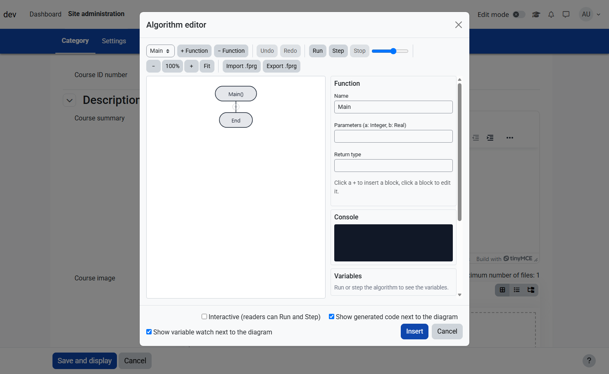
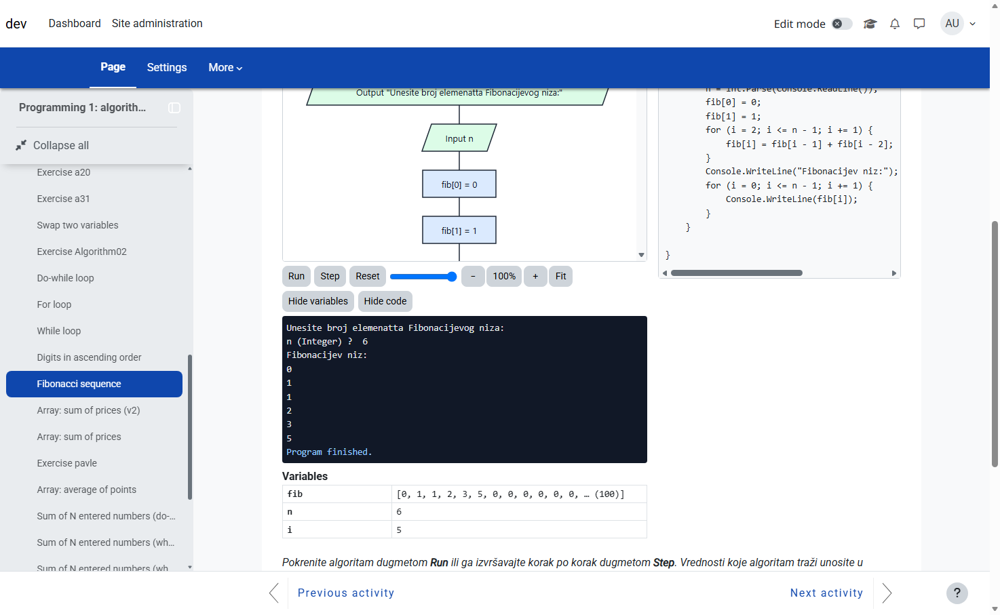
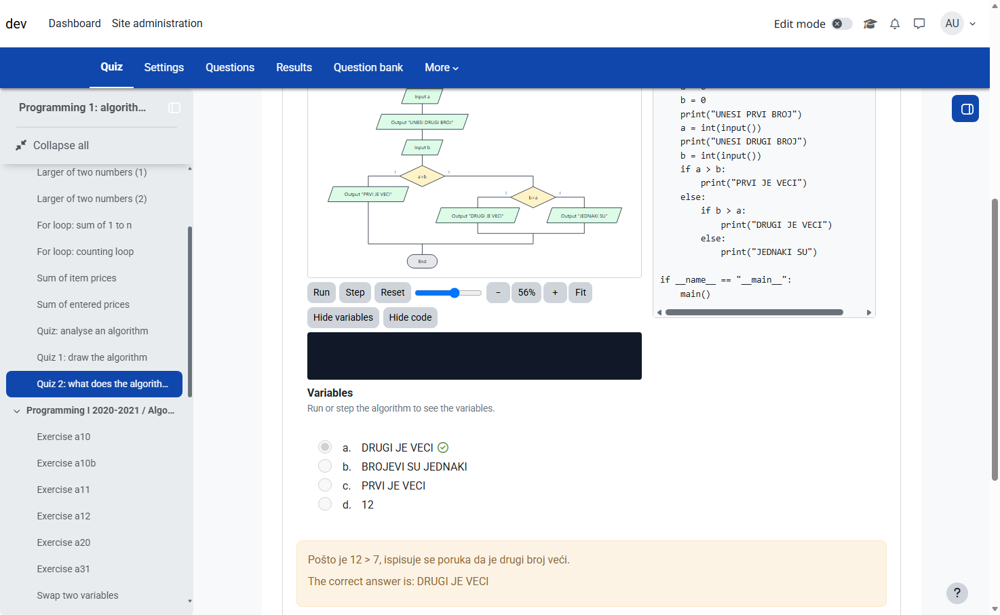
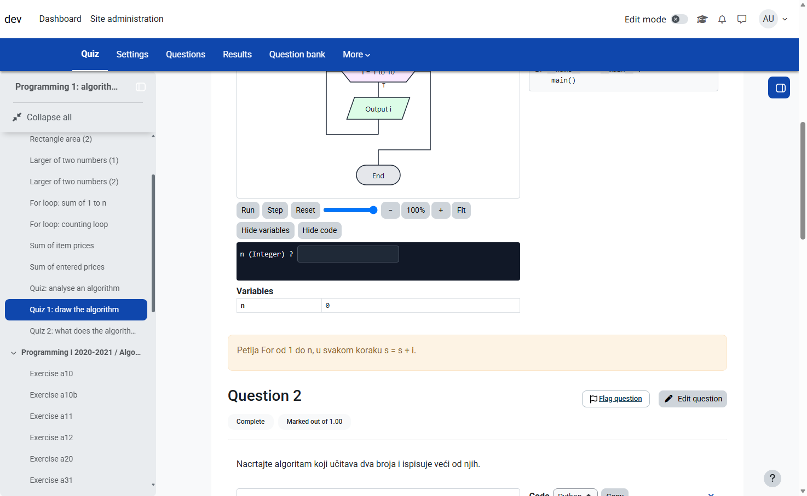

# Tiny Algorithm - Flowchart Editor for Moodle

[](https://github.com/blagojevicboban/moodle-tiny_algorithm/actions/workflows/ci.yml)
[](https://moodle.org)
[](https://php.net)
[](LICENSE)

**Tiny Algorithm** is a TinyMCE plugin for Moodle that lets teachers and students draw algorithms as
[Flowgorithm](https://www.flowgorithm.org/)-style flowcharts directly in the text editor, run them step by step, import and
export Flowgorithm `.fprg` files and generate **Python**, **C**, **C++**, **Java**, **C#**, **JavaScript** or **Pascal** code -
without leaving the editor.

> Status: **stable** (1.0). Inspired by Flowgorithm, not affiliated with it.

## ✨ Features

| Feature | Description |
|---------|-------------|
| 🧱 **Visual Editor** | Declare, Assign, Input, Output, If, For, While, Do…While, Call, Return, Comment; several functions, undo / redo |
| ▶️ **Interpreter** | Run / Step / Stop with a speed slider, the running block is highlighted, console with input prompts |
| 🛡️ **Safe Execution** | Infinite-loop guard and clear errors (undeclared variable, division by zero, index out of range) |
| 🔍 **Variable Watch** | Current value of every variable while stepping, changed values highlighted, long arrays shortened |
| 🔎 **Zoom** | **−**, **+**, **100%**, **Fit** buttons or **Ctrl + mouse wheel** |
| 📂 **Flowgorithm Files** | Import and export real `.fprg` files; unsupported elements are reported, not silently dropped |
| 💻 **Code Generation** | Python, C, C++, Java, C#, JavaScript and Pascal; the tests compile and run the generated programs and compare them with the interpreter |
| 🖼️ **Editable Images** | The diagram is a normal SVG image that stores its model - double-click it to edit again |
| ✍️ **Students Edit and Test** | Let students change their own copy of a diagram in any content, run the teacher's tests and see the differences (with `filter_algorithm`) |
| 🧪 **Tests from the Solution** | The teacher enters only the inputs; the expected outputs are computed from the teacher's solution |
| 🧩 **Starting Template** | Students can start from an empty or partial template instead of the solution; the solution can be shown on request |
| ⚙️ **Per-diagram Options** | *Interactive*, *Show generated code*, *Show variable watch* (turn code off in quiz questions) |
| 🌐 **Languages** | English, Serbian Latin and Serbian Cyrillic |
| 🔒 **Privacy** | GDPR compliant (Privacy API, no personal data stored) |

## 🖼️ Screenshots

| | |
|---|---|
| **Editor** | **Reader view (Run, code, variables)** |
|  |  |
| **Quiz: analyse an algorithm** | **Quiz: draw an algorithm** |
|  |  |

## 📋 Requirements

- **Moodle**: 4.5 LTS or newer (4.5, 5.0, 5.1, 5.2 and 5.3 tested)
- **PHP**: 8.2+
- **Editor**: TinyMCE (the default editor)
- **Database**: MySQL, MariaDB or PostgreSQL (the plugin has no tables)

## 🔌 Related Plugins

| Plugin | Purpose |
|--------|---------|
| [filter_algorithm](https://github.com/blagojevicboban/moodle-filter_algorithm) | Gives readers **Run / Step / Reset** on diagrams marked *Interactive* |
| [qtype_algorithm](https://github.com/blagojevicboban/moodle-qtype_algorithm) | Quiz question type where the student draws the algorithm |

Both depend on this plugin, so install it first.

## 🚀 Installation

### Via Git
```bash
cd /path/to/moodle/public/lib/editor/tiny/plugins     # Moodle 5.1+; use lib/editor/tiny/plugins before 5.1
git clone https://github.com/blagojevicboban/moodle-tiny_algorithm.git algorithm
php admin/cli/upgrade.php
```

### Via Download
1. Download the [latest release](https://github.com/blagojevicboban/moodle-tiny_algorithm/releases)
2. Extract to `lib/editor/tiny/plugins/algorithm` (`public/lib/...` in Moodle 5.1+)
3. Visit Site Administration → Notifications

The **Algorithm** button appears in the *advanced* toolbar group and under **Insert → Algorithm…**. To move it, edit the toolbar
under Site administration → Plugins → Text editors → TinyMCE editor → General settings. The compiled AMD modules are included
in `amd/build`.

## 📖 Usage

### For Teachers and Students

1.  **Open the editor**: In any TinyMCE field (Page, course summary, forum post…) click **Algorithm** (or **Insert → Algorithm…**).
2.  **Build the flowchart**:
    -   Click a **+** between blocks to insert a block.
    -   Click a block to edit its properties; use **Up / Down / Delete** to arrange.
3.  **Test it**: **Run** or **Step**; the console asks for *Input* values and the variable watch shows the state.
4.  **Import / Export**: **Import .fprg** loads a Flowgorithm file, **Export** saves one.
5.  **Insert**: Optionally tick **Interactive**, then click **Insert**. Double-click the image later to edit it.

### Exercises: Students Edit and Test

1.  Draw the solution in the **Solution** tab and tick **Students can edit and test the algorithm**.
2.  Optionally, in **Starting template**, tick *Students start from a separate template* and click **Empty** or
    **Copy from the solution**, then remove the parts students should add.
3.  In **Tests**, add tests and type the inputs (one value per line; a line with only `""` is an
    empty value, e.g. an empty text). The expected outputs are computed from the solution
    when you click **Compute expected outputs** and again on **Insert**; if the solution fails on a test, the dialog says so.
4.  Tick **Students can show the solution** if they may look at it, then **Insert** and save.

With `filter_algorithm` enabled, students see **Edit**, **Restore original**, **Full screen**, **Show solution** (when allowed)
and **Test**: every test is marked ✓ or ✗, failed tests show the expected and actual output side by side with the first
different line highlighted. When the student changes the algorithm after a test run, the results are greyed out until
they test again. The student's copy is kept in their browser, so it is still there after a reload.

### Expressions

Follow Flowgorithm: `+ - * / ^ mod`, comparisons `= <> < <= > >=`, logic `and or not`, string join `&`, and functions such as
`Sqrt`, `Abs`, `Floor`, `Ceiling`, `Round`, `Len`, `ToInt`, `ToReal`, `ToString`, `Random`, and for strings `Char(s, i)`
(character at index `i`, from 0), `ToChar(n)` and `ToCode(s)`. Variable names are case insensitive,
one *Declare* block may list several names (`a, b, p`), arrays use `name[index]`, user functions may be recursive.

## 🔑 Permissions

| Capability | Purpose | Default roles |
|------------|---------|---------------|
| `tiny/algorithm:viewplugin` | Shows the **Algorithm** button in the editor | Manager, Teacher, Editing Teacher, Student |

## 🛠️ Development

```bash
# Rebuild AMD modules after changing amd/src (from the Moodle root)
npx grunt amd --root=public/lib/editor/tiny/plugins/algorithm

# Run the Node tests (parser, interpreter, code generator, .fprg import / export, renderer)
node --import ./tests/register.mjs --test "tests/*.test.mjs"
```

The generators are checked by running the generated code and comparing it with the interpreter: Python, JavaScript (Node),
C# (needs the .NET SDK), C++ (`g++`, or `python -m ziglang c++`) and Pascal (`fpc`); a test is skipped when its tool is missing.
The GitHub workflow runs all of them.
C and Java output is generated but not compiled by the tests.

## 📁 Structure

```
lib/editor/tiny/plugins/algorithm/
├── amd/
│   ├── src/          # JavaScript modules (model, parser, interpreter, layout, render, codegen, editor, runner…)
│   └── build/        # Compiled modules
├── classes/          # plugininfo, privacy provider
├── db/               # Capabilities
├── lang/             # en, sr_lt, sr_cr
├── tests/            # Node tests
├── styles.css
└── version.php       # Plugin metadata
```

## ⚠️ Known Limitations

- Variable names are case insensitive in the interpreter, but not in the generated code.
- Arrays, functions and `.fprg` import are verified by the Node tests and real Flowgorithm files, not inside the Moodle dialog.
- Exercises are for practice, not for assessment: the solution and the expected outputs are part of the page HTML, and nothing
  is graded or sent to the server.
- A student's edited copy lives in the browser (`localStorage`) and does not follow them to another device or browser. When the
  teacher changes the diagram or its tests, students start again from the new version.

## 🌍 Languages

- 🇬🇧 English
- 🇷🇸 Srpski (Serbian, Latin: sr_lt)
- 🇷🇸 Српски (Serbian, Cyrillic: sr_cr)

## 📝 Changelog

See [CHANGELOG.md](CHANGELOG.md).

## 📄 License

GNU GPL v3 or later - see [LICENSE](LICENSE).

## 👤 Author

**Boban Blagojević**  
[GitHub](https://github.com/blagojevicboban)

## 🙏 Credits

- [Flowgorithm](https://www.flowgorithm.org/) - the flowchart style and `.fprg` file format that inspired this plugin
- [TinyMCE](https://www.tiny.cloud/) - the editor it extends

---

Made with ❤️ for teaching programming
